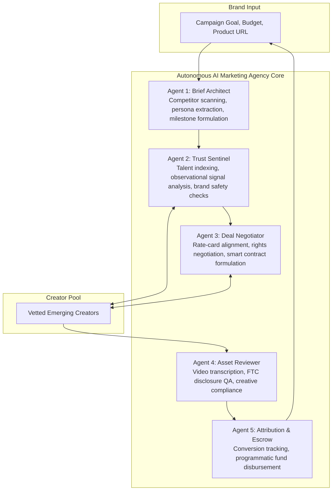

# CollabTrust: Autonomous AI Marketing Agency Architecture & Demo Guide

This document outlines the strategic product vision, multi-agent architecture roadmap, and live demonstration protocol for CollabTrust.

---

## 1. The Autonomous AI Marketing Agency Vision

Traditional influencer agencies operate as high-overhead, manual intermediaries charging 20–35% markups and high monthly retainers. CollabTrust evolves the traditional influencer marketplace into a **decentralized, autonomous marketing agency** powered by cooperating autonomous agents.

---

## 2. Multi-Agent System (MAS) Breakdown

### Agent 1: Brief Architect (Strategic Planning)
- **Role**: Automatically extracts brand aesthetic, competitor positioning, and target audiences from product URLs and social handles.
- **Protocol**: Sanitizes input using strict XML boundary encapsulation, synthesizing structured deliverables, milestones, and creator requirements without manual brief writing.

### Agent 2: Trust Sentinel (Talent Discovery & Verification)
- **Role**: Continuous observational analysis of creator performance metrics.
- **Protocol**: Adheres to non-verdict trust principles. Surfaces factual evidence (e.g. self-reported audience tags, engagement consistency patterns) backed by the mandatory advisory disclaimer. Avoids subjective fraud labels.

### Agent 3: Deal Negotiator (Agreement & Conflict Protocols)
- **Role**: Mediates collaboration parameters between brands and creators.
- **Protocol**: Enforces an explicit mutual confirmation gate (`invited` -> `accepted` -> `in_progress`). Prevents unilateral work activation.

### Agent 4: Asset Reviewer (Compliance & Creative QA)
- **Role**: Pre-screens submitted creator video and story deliverables.
- **Protocol**: Verifies FTC disclosure compliance (`#ad`, `#sponsored`), correct aspect ratios, audio clarity, and guideline adherence before brand sign-off.

### Agent 5: Attribution & Escrow Agent (FinOps & Analytics)
- **Role**: Manages milestone escrow deposits and programmatic releases.
- **Protocol**: Verifies live social post publication and metrics before triggering smart contract fund transfers.

---

## 3. Step-by-Step Live Demo Protocol

To showcase that the platform is dynamic and functional rather than relying on pre-seeded records:

1. **Brand Brief Generation**:
   - Navigate to `/campaigns/new` in Brand View.
   - Enter an organic product concept into the prompt box.
   - Click **"Structure with AI"** and **"Publish Campaign & Find Matches"**.
   - Show how the brief is structured and saved into PostgreSQL in real time.

2. **Transparent Fit Scoring**:
   - Inspect the candidate match breakdown on `/campaigns/:id/matches`.
   - Point out the AI fit rationale (Niche Overlap, Audience Match, Engagement Quality) and observational trust signals.

3. **Creator Marketplace Pitch**:
   - Switch to Creator View using the top navbar role switcher.
   - Navigate to `/explore` to show the newly created campaign active in the marketplace feed.
   - Submit a personalized pitch note via the standardized application modal.

4. **Review & Collaboration Hub**:
   - Switch back to Brand View. Open `/dashboard` to see the pending application alert.
   - Accept the application to initialize a collaboration in status `invited`.
   - Show the creator confirmation gate and exchange live messages in the collaboration chat.
