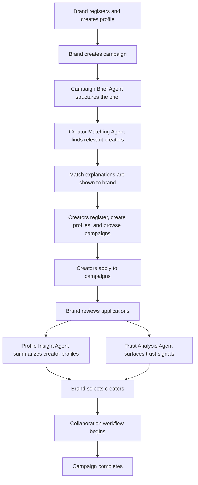

# CollabTrust — MVP Scope

> **Status:** Draft  
> **Phase:** 2.7 — MVP Scope  
> **Depends on:** [`product-vision.md`](./product-vision.md), [`problem-definition.md`](./problem-definition.md), [`goals-success-metrics.md`](./goals-success-metrics.md)  
> **Source of truth:** [`PROJECT_CONTEXT.md`](../../PROJECT_CONTEXT.md)

---

## 1. MVP Objective

The MVP aims to validate the following hypotheses before investing in a full-featured platform:

1. **The core marketplace loop works end-to-end.** A brand can create a campaign, discover matching creators, review their profiles and trust signals, select creators, and begin a collaboration — all within a single platform.

2. **AI agents produce useful, explainable outputs.** The Campaign Brief Agent, Creator Matching Agent, Trust Analysis Agent, and Profile Insight Agent generate outputs that users find genuinely helpful and whose reasoning users can understand.

3. **Both brands and creators find value.** Brands find the platform useful for discovering and evaluating relevant creators. Creators find the platform useful for discovering legitimate, relevant brand opportunities.

4. **The platform is accessible to small brands and emerging creators.** The experience is designed for users who lack large marketing teams, dedicated influencer budgets, or existing industry networks — the underserved segment identified in the [problem definition](./problem-definition.md).

> [!IMPORTANT]
> The MVP is a validation tool, not a production-ready product. The goal is to prove or disprove these hypotheses with the minimum viable feature set.

---

## 2. MVP Core Loop

The MVP must support the following end-to-end flow. Each step is essential to validating the marketplace hypothesis.

### Step-by-step detail

| Step | Description | AI Agent Involved |
|---|---|---|
| **Brand registration & profile** | Brand signs up, creates a profile describing their company, category, goals, and budget range. | — |
| **Campaign creation** | Brand describes their campaign idea in free text or guided form. | **Campaign Brief Agent** converts free text into a structured, editable campaign draft. |
| **Creator registration & profile** | Creator signs up, creates a profile describing their niche, platforms, audience, content style, and collaboration preferences. | — |
| **Creator discovery / matching** | System identifies creators whose profiles align with campaign requirements. | **Creator Matching Agent** produces ranked matches with explanations of why each creator fits. |
| **Creator applies** | Creators browse available campaigns and apply to ones that match their interests and niche. | — |
| **Brand reviews creators** | Brand views creator profiles, match explanations, trust signals, and profile summaries. | **Profile Insight Agent** summarizes creator profile data. **Trust Analysis Agent** surfaces trust signals and potential anomalies. |
| **Brand selects creators** | Brand makes the final decision on which creators to collaborate with. This is a human decision — AI assists, not decides. | — |
| **Collaboration workflow** | Basic status tracking for the collaboration (e.g., invited → accepted → in progress → completed). | **Collaboration Assistant** (simplified or deferred — see Section 5). |
| **Campaign completion** | Campaign is marked as complete. | — |

---

## 3. MVP Features — In Scope

Features are prioritized using MoSCoW classification:

- **MUST-HAVE** — Required for the MVP to validate the core loop. The MVP cannot ship without these.
- **SHOULD-HAVE** — Strongly expected and will be included if time permits. Their absence would noticeably weaken the MVP.
- **NICE-TO-HAVE** — Valuable but can be deferred without blocking core validation.

### 3.1 Authentication & Profiles

| Feature | Priority | Notes |
|---|---|---|
| User registration (email + password) | **MUST-HAVE** | Separate flows for brands and creators. |
| User login / logout | **MUST-HAVE** | JWT or session-based (TBD). |
| Brand profile creation and editing | **MUST-HAVE** | Company name, category, description, budget range, goals. |
| Creator profile creation and editing | **MUST-HAVE** | Niche, platforms, audience size, content style, collaboration preferences. |
| Profile viewing (public-facing) | **MUST-HAVE** | Brands can view creator profiles; creators can view brand profiles. |
| Password reset | **SHOULD-HAVE** | — |
| Profile image upload | **NICE-TO-HAVE** | — |

### 3.2 Campaigns

| Feature | Priority | Notes |
|---|---|---|
| Campaign creation (free-text input) | **MUST-HAVE** | Brand enters campaign idea as free text or guided fields. |
| Campaign Brief Agent structuring | **MUST-HAVE** | AI converts free text into a structured, editable campaign draft. |
| Campaign editing | **MUST-HAVE** | Brand can review and modify the AI-structured brief before publishing. |
| Campaign listing (for creators) | **MUST-HAVE** | Creators can browse available campaigns. |
| Campaign detail view | **MUST-HAVE** | Creators can view full campaign details before applying. |
| Campaign status management | **SHOULD-HAVE** | Draft → Active → Closed. |
| Campaign filtering / search | **SHOULD-HAVE** | Creators can filter campaigns by category, budget range, etc. |

### 3.3 AI Agents

| Feature | Priority | Notes |
|---|---|---|
| Campaign Brief Agent | **MUST-HAVE** | Priority 1 per hackathon priority order. Structures free-text campaign ideas into editable drafts. |
| Trust Analysis Agent | **MUST-HAVE** | Priority 2. Surfaces trust signals and potential anomalies. Must present signals only — no fraud guarantees or definitive authenticity verdicts. |
| Creator Matching Agent | **MUST-HAVE** | Priority 3. Matches creators to campaigns with ranked results and match explanations. |
| Match explanations | **MUST-HAVE** | Part of Creator Matching Agent output. Each match includes human-readable reasoning. |
| Profile Insight Agent | **SHOULD-HAVE** | Summarizes creator profile data for brand review. Included if feasible within timeline. |
| Collaboration Assistant | **NICE-TO-HAVE** | Drafts communication and checklists. Deferred or heavily simplified for MVP. |
| Workflow Coordinator | **NICE-TO-HAVE** | Workflow routing and state tracking. Deferred or heavily simplified for MVP. |

> [!WARNING]
> Trust Analysis Agent must NOT claim to detect fraud or guarantee creator authenticity. It surfaces available signals (e.g., engagement patterns, profile completeness, account age indicators) and flags potential anomalies. Users interpret the signals and make their own decisions. See [product-vision.md § Principle 3](./product-vision.md) and [problem-definition.md § 10](./problem-definition.md).

### 3.4 Matching & Discovery

| Feature | Priority | Notes |
|---|---|---|
| AI-powered creator matching for campaigns | **MUST-HAVE** | Core to the marketplace value proposition. |
| Match explanation display | **MUST-HAVE** | Explainability is a core product principle. |
| Creator browsing / search by brand | **SHOULD-HAVE** | Manual browsing as a complement to AI matching. |
| Campaign browsing / search by creator | **MUST-HAVE** | Creators need a way to discover campaigns. |
| Creator application to campaigns | **MUST-HAVE** | Creators can express interest / apply. |

### 3.5 Collaboration Workflow

| Feature | Priority | Notes |
|---|---|---|
| Basic collaboration status tracking | **MUST-HAVE** | Minimal statuses: Invited → Accepted → In Progress → Completed. |
| Simple messaging or communication | **SHOULD-HAVE** | Basic in-platform messaging between brand and creator for an active collaboration. Could be simplified to a comment/note thread. |
| Collaboration checklist / requirements | **NICE-TO-HAVE** | Deferred unless Collaboration Assistant is included. |

### 3.6 Admin

> **Removed from MVP scope (2026-10-20):** An admin role/dashboard is **not** part of the MVP (only `brand` and `creator` roles exist per FR-001). The row previously here is now listed under §4.

---

## 4. MVP Features - Explicitly Out of Scope

The following features are planned for future phases but are **not included** in the MVP. This boundary is intentional to keep scope focused on validating the core marketplace loop.

| Feature | Reason for Exclusion |
|---|---|
| **Payment processing** | High regulatory and trust complexity; not required to validate the core matching and collaboration loop. |
| **Autonomous outreach** | Conflicts with the "AI-assisted, human-controlled" principle (see [product-vision.md § Principle 2](./product-vision.md)). |
| **Advanced analytics / campaign performance dashboards** | Post-campaign analytics are valuable but not required for MVP validation. |
| **Multi-platform social API integrations** | May be introduced incrementally post-MVP. MVP relies on self-reported creator profile data. |
| **Legal contract generation** | Requires legal review and is out of scope for initial validation. |
| **Notification system (beyond basic)** | Basic in-app indicators may be included; push notifications, email notifications, and real-time alerts are deferred. |
| **Mobile application** | MVP is a web application only. Responsive design is desirable but a dedicated mobile app is post-MVP. |
| **Collaboration Assistant agent (full version)** | May be deferred or heavily simplified per hackathon priority. See Section 5. |
| **Workflow Coordinator agent (full version)** | May be deferred or heavily simplified per hackathon priority. See Section 5. |
| **Rating / review system** | Post-collaboration reputation tracking is post-MVP. |
| **Multi-language support** | English only for MVP. |
| **Autonomous payments, dispute resolution** | Explicitly excluded per [product-vision.md § 8](./product-vision.md). |
| **Admin role & admin dashboard** | Moved out of MVP on 2026-10-20; only `brand` and `creator` roles exist (FR-001). Requires new requirements, schema, and access-control changes before introduction. |

---

## 5. AI Agents in MVP

Each planned agent is mapped to its MVP inclusion status, aligned with the hackathon priority order defined in [`PROJECT_CONTEXT.md` § 4](../../PROJECT_CONTEXT.md).

| Agent | MVP Status | Priority | Notes |
|---|---|---|---|
| **Campaign Brief Agent** | ✅ MVP | 1 | Converts free-text campaign ideas into structured, editable campaign drafts. Core to the campaign creation flow. |
| **Trust Analysis Agent** | ✅ MVP | 2 | Surfaces trust signals and potential anomalies on creator profiles. Signals only — no fraud detection guarantees. |
| **Creator Matching Agent** | ✅ MVP | 3 | Matches creators to campaigns with ranked results and human-readable match explanations. |
| **Profile Insight Agent** | ✅ MVP (if feasible) | 4 | Summarizes creator profile data. Include if timeline permits; otherwise defer. |
| **Collaboration Assistant** | ⏸️ Deferred / Simplified | — | Full agent deferred. If included, limited to basic draft generation. |
| **Workflow Coordinator** | ⏸️ Deferred / Simplified | — | Full agent deferred. Workflow state can be managed with simple application logic for MVP. |

### Agent design constraints for MVP

- All agents are **human-controlled**: outputs are recommendations, summaries, or drafts that users review and act on.
- No agent performs **autonomous outreach, payments, or dispute resolution**.
- Agent outputs must be **explainable**: match recommendations explain why; trust signals explain what was observed.
- Agent outputs must use **structured schemas** to enable consistent UI rendering and future evaluation.

---

## 6. Technical Scope for MVP

The MVP targets a simple, deployable architecture. No complex infrastructure is required at this stage.

| Component | MVP Approach | Notes |
|---|---|---|
| **Web application** | Single-page application (React, TypeScript, Tailwind CSS) | One deployable frontend. |
| **API server** | Node.js, Express, TypeScript | One deployable backend. REST API with OpenAPI/Swagger documentation. |
| **Database** | PostgreSQL with Prisma ORM | Single relational database. |
| **LLM integration** | LLM API calls from the backend | Provider TBD (see Section 9). No fine-tuned models for MVP. |
| **Authentication** | JWT or session-based (TBD) | Basic email/password authentication. No OAuth/social login for MVP. |
| **Deployment** | Single deployable unit per layer (web + API) | Deployment platform TBD (see Section 9). |

### Explicitly excluded from MVP infrastructure

- Message queues or event buses
- Microservices architecture
- Kubernetes or container orchestration
- CDN or advanced caching layers
- Real-time WebSocket connections (unless basic messaging requires it)
- Background job processing (unless a simple solution is needed for agent calls)

> [!NOTE]
> The proposed technical direction is documented in [product-vision.md § 10](./product-vision.md) and [`PROJECT_CONTEXT.md` § 7](../../PROJECT_CONTEXT.md). Final technology decisions will be recorded in Architecture Decision Records under `docs/03-architecture/ADR/`.

---

## 7. MVP Constraints

| Constraint | Description |
|---|---|
| **Time** | Hackathon timeline. Exact duration TBD, but scope must be achievable within a short, focused development period. |
| **Team** | Small team. Architecture and tooling must be simple enough for a small team to build, test, and deploy. |
| **Budget** | Minimal. LLM API costs must be considered; no paid enterprise services unless essential. |
| **Scope** | Only the core marketplace loop and the highest-priority AI agents. All non-essential features are deferred. |
| **Data** | MVP may use self-reported creator data and/or seed data. No social media API integrations required. |
| **AI accuracy** | Agent outputs are best-effort. No production-grade evaluation or fine-tuning is expected for MVP. |

---

## 8. Success Criteria for MVP

The MVP is successful if it demonstrates the following:

| Criterion | How to Evaluate |
|---|---|
| **Core loop completeness** | A brand can register, create a campaign, receive AI-structured brief, view matched creators with explanations, review trust signals and profile summaries, select a creator, and track the collaboration to completion. |
| **AI usefulness** | Campaign Brief Agent produces a structured draft that brands find useful to edit. Creator Matching Agent produces relevant matches with understandable explanations. Trust Analysis Agent surfaces signals that brands find informative. |
| **Two-sided value** | Brands report that the platform helps them discover and evaluate creators. Creators report that the platform helps them find relevant opportunities. |
| **Accessibility** | The platform is usable by a small brand without a marketing team and by an emerging creator without existing platform connections. |
| **Explainability** | Users can understand why a creator was matched to a campaign and what trust signals mean. |
| **Human control** | All important decisions (creator selection, collaboration acceptance) are made by users, not by AI. |

> [!NOTE]
> Specific quantitative metrics (e.g., task completion rates, satisfaction scores, time-to-match targets) should be defined in [`goals-success-metrics.md`](./goals-success-metrics.md). This document will be cross-referenced once available.

---

## 9. Assumptions and Open Questions

### Assumptions

| # | Assumption | Status | Notes |
|---|---|---|---|
| A1 | The core marketplace loop can be built within the hackathon timeline with the planned tech stack. | **Assumption** | Depends on final scope and team capacity. |
| A2 | Self-reported creator profile data is sufficient for meaningful AI matching in the MVP. | **Assumption** | Social API integrations are deferred; matching quality depends on profile completeness. |
| A3 | LLM API calls can produce structured, useful outputs for campaign briefs, matching, and trust analysis. | **Assumption** | Needs technical validation during development. |
| A4 | A simplified collaboration workflow (status tracking) is sufficient to demonstrate the end-to-end loop. | **Assumption** | Full collaboration management is deferred. |
| A5 | Users will provide enough profile information for matching to work. | **Assumption** | UX must guide users toward complete profiles. |

### Open Questions

| # | Question | Impact | Notes |
|---|---|---|---|
| Q1 | What niche should the MVP launch with to address cold-start? | High | Determines seed data, sample campaigns, and matching relevance. Not yet decided. |
| Q2 | What is the cold-start strategy? | High | How to get both brands and creators on the platform initially. Options include seed data, invite-only launch, niche community partnerships. Not yet decided. |
| Q3 | Which LLM provider and model will be used? | Medium | Affects cost, latency, output quality. Provider TBD. |
| Q4 | What is the deployment platform? | Medium | Affects CI/CD setup and infrastructure cost. TBD. |
| Q5 | Should Profile Insight Agent be included or deferred? | Medium | Depends on timeline. Currently classified as SHOULD-HAVE. |
| Q6 | Should Collaboration Assistant be included in any form? | Low–Medium | Currently classified as NICE-TO-HAVE / deferred. |
| Q7 | What is the minimum viable creator profile for useful matching? | Medium | Needs to be defined in feature requirements. |
| Q8 | What is the minimum viable campaign brief for useful matching? | Medium | Needs to be defined in feature requirements. |

---

## 10. Related Documents

| Document | Purpose | Status |
|---|---|---|
| [`product-vision.md`](./product-vision.md) | Mission, vision, principles, core loop, and product boundaries | Defined |
| [`problem-definition.md`](./problem-definition.md) | Problems, root causes, consequences, and marketplace gap | Defined |
| [`goals-success-metrics.md`](./goals-success-metrics.md) | Product goals and measurable success criteria | Pending |
| [`feature-requirements.md`](./feature-requirements.md) | Detailed feature requirements (Phase 2.8) | Pending |
| [`PROJECT_CONTEXT.md`](../../PROJECT_CONTEXT.md) | Master handoff document; phase status, AI direction, working rules | Current |
