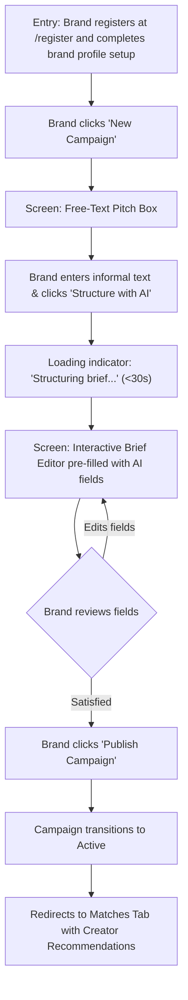
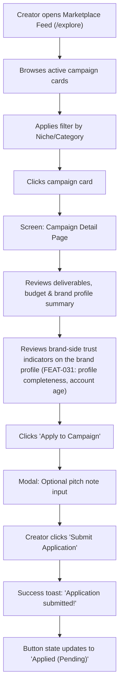
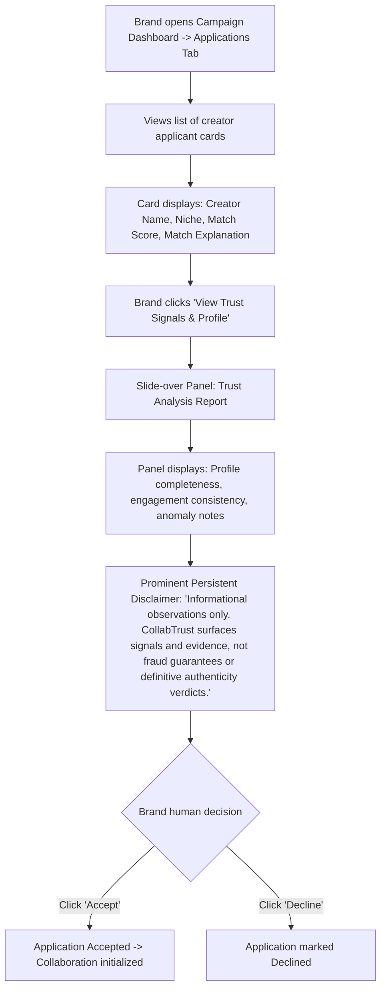
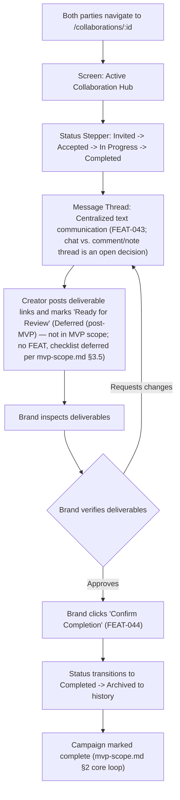

# CollabTrust — UX User Flows

> **Status:** Draft  
> **Phase:** Phase 6 — Design  
> **Depends on:** [`user-journeys.md`](../01-product/user-journeys.md), [`feature-requirements.md`](../01-product/feature-requirements.md)  
> **Source of truth:** [`PROJECT_CONTEXT.md`](../../PROJECT_CONTEXT.md)  

---

## 1. Overview & Information Architecture

CollabTrust's user experience is designed for intuitive, low-friction interactions tailored to two distinct user roles: **Brands** (e.g., small brand founder Priya) and **Creators** (e.g., emerging creator Maya).

### High-Level Sitemaps

#### Brand Sitemap
```
/
├── /login & /register
├── /dashboard (Active campaigns, applications, active collaborations)
├── /campaigns
│   ├── /new (Free-text entry -> AI Structuring preview -> Edit brief)
│   ├── /:id (Campaign detail, status controls)
│   ├── /:id/matches (Ranked creator matches with match explanations)
│   └── /:id/applications (Submitted applications review + Trust Signal panel)
├── /creators/:id (Creator profile — authenticated brand viewers; self-reported platform/audience data, trust signals)
├── /collaborations/:id (Milestone status tracking, message thread — open decision: chat vs. comment/note thread, see mvp-scope.md §3.5)
└── /settings/profile (Brand company details)
```

#### Creator Sitemap
```
/
├── /login & /register
├── /dashboard (Matched opportunities, submitted applications, collaborations)
├── /explore (Marketplace feed of active brand campaigns, filters)
├── /campaigns/:id (Campaign detail view, brand profile summary, Apply button)
├── /applications (Track submitted application statuses)
├── /collaborations/:id (Collaboration status tracking, message thread)
└── /settings/profile (Creator bio, self-reported platforms and audience figures, completeness)
```

---

## 2. Core User Flows

### 2.1 Flow 1: Brand Campaign Creation with AI Structuring



* **Entry Point:** Registration (`/login & /register`) and brand profile setup precede this flow (per [`mvp-scope.md` §3.1](../01-product/mvp-scope.md)); the flow as drawn begins once the brand has a completed profile and is on the dashboard.
* **Key Screen States:** Free-text input box; loading spinner with cancellation option; multi-field editable form (Title, Goals, Target Audience, Deliverables, Timeline, Budget, Requirements); confirmation modal for publishing.

---

### 2.2 Flow 2: Creator Campaign Discovery & Application



* **Key Screen States:** Filterable card grid; detailed campaign view; brand-side trust indicator strip on the brand profile ([`FEAT-031`](../01-product/feature-requirements.md)); pitch note modal; pending application badge.

---

### 2.3 Flow 3: Brand Reviewing Applications & Trust Signals



* **Key Screen States:** Applications table/list; detailed applicant profile slide-over; trust signal cards with severity tags (`info`, `anomaly`); persistent disclaimer banner; Accept/Decline action buttons.

---

### 2.4 Flow 4: Collaboration State Tracking & Delivery



* **Key Screen States:** Progress stepper; split view with deliverable checklist on left and chronological message thread on right; completion modal. The deliverable checklist and "Ready for Review" controls are **Deferred (post-MVP) — not in MVP scope** (no FEAT exists; the collaboration checklist is NICE-TO-HAVE/deferred per [`mvp-scope.md` §3.5](../01-product/mvp-scope.md)). Collaboration completion is covered by [`FEAT-044`](../01-product/feature-requirements.md).

---

## 3. Flow-to-Journey Mapping

Each flow above implements one or more of the narrative journeys defined in [`user-journeys.md`](../01-product/user-journeys.md):

| Flow | Journey(s) | Coverage Notes |
|---|---|---|
| Flow 1 — Brand Campaign Creation (§2.1) | [J-1: Brand Campaign Journey](../01-product/user-journeys.md#3-j-1-brand-campaign-journey) | J-1 steps 1–6: registration/profile setup through viewing matched creators. |
| Flow 2 — Creator Campaign Discovery & Application (§2.2) | [J-2: Creator Discovery Journey](../01-product/user-journeys.md#4-j-2-creator-discovery-journey), [J-4: Creator Evaluating a Brand Opportunity](../01-product/user-journeys.md#6-j-4-creator-evaluating-a-brand-opportunity) | J-2 steps 3–7 (browse → apply); J-4 steps 1–6 occur on the campaign detail page (including brand-side trust indicators, FEAT-031). |
| Flow 3 — Brand Reviewing Applications & Trust Signals (§2.3) | [J-3: Brand Evaluating Trust Signals](../01-product/user-journeys.md#5-j-3-brand-evaluating-trust-signals), [J-1: Brand Campaign Journey](../01-product/user-journeys.md#3-j-1-brand-campaign-journey) | J-3 steps 1–6 (trust signal review); J-1 steps 9–11 (applications review and creator selection). |
| Flow 4 — Collaboration State Tracking & Delivery (§2.4) | [J-1: Brand Campaign Journey](../01-product/user-journeys.md#3-j-1-brand-campaign-journey), [J-2: Creator Discovery Journey](../01-product/user-journeys.md#4-j-2-creator-discovery-journey) | J-1 steps 12–13 and J-2 steps 9–10: collaboration tracking through collaboration and campaign completion. |

---

## 4. Related Documents

| Document | Purpose |
|---|---|
| [`design-system.md`](./design-system.md) | Visual design tokens, typography, and UI components |
| [`wireframes/README.md`](./wireframes/README.md) | Wireframe layouts and screen structural blueprints |
| [`user-journeys.md`](../01-product/user-journeys.md) | Narrative user journeys |
