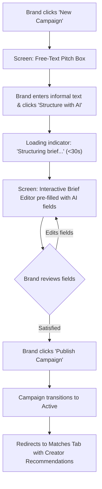
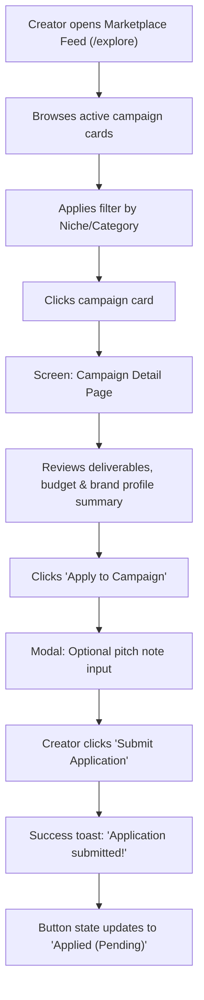
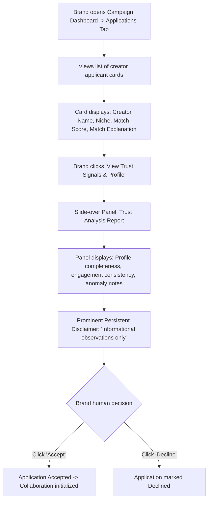
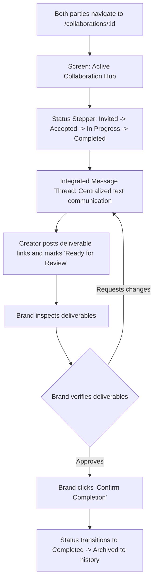

# CollabTrust — UX User Flows

> **Status:** Draft  
> **Phase:** Phase E — Design  
> **Depends on:** [`user-journeys.md`](../01-product/user-journeys.md), [`feature-requirements.md`](../01-product/feature-requirements.md)  
> **Source of truth:** [`PROJECT_CONTEXT.md`](../../PROJECT_CONTEXT.md)  

---

## 1. Overview & Information Architecture

CollabTrust's user experience is designed for intuitive, low-friction interactions tailored to two distinct user roles: **Brands** (e.g., small brand founder Priya) and **Creators** (e.g., emerging creator Maya).

### High-Level Sitemaps

#### Brand Sitemap
```
/
├── /login & /register
├── /dashboard (Active campaigns, applications, active collaborations)
├── /campaigns
│   ├── /new (Free-text entry -> AI Structuring preview -> Edit brief)
│   ├── /:id (Campaign detail, status controls)
│   ├── /:id/matches (Ranked creator matches with match explanations)
│   └── /:id/applications (Submitted applications review + Trust Signal panel)
├── /creators/:id (Public creator profile, channel overview, trust signals)
├── /collaborations/:id (Milestone status tracking, message thread)
└── /settings/profile (Brand company details)
```

#### Creator Sitemap
```
/
├── /login & /register
├── /dashboard (Matched opportunities, submitted applications, collaborations)
├── /explore (Marketplace feed of active brand campaigns, filters)
├── /campaigns/:id (Campaign detail view, brand profile summary, Apply button)
├── /applications (Track submitted application statuses)
├── /collaborations/:id (Deliverable milestone checklist, message thread)
└── /settings/profile (Creator bio, connected channels, audience metrics, completeness)
```

---

## 2. Core User Flows

### 2.1 Flow 1: Brand Campaign Creation with AI Structuring



* **Key Screen States:** Free-text input box; loading spinner with cancellation option; multi-field editable form (Title, Goals, Target Audience, Deliverables, Timeline, Budget, Requirements); confirmation modal for publishing.

---

### 2.2 Flow 2: Creator Campaign Discovery & Application



* **Key Screen States:** Filterable card grid; detailed campaign view; pitch note modal; pending application badge.

---

### 2.3 Flow 3: Brand Reviewing Applications & Trust Signals



* **Key Screen States:** Applications table/list; detailed applicant profile slide-over; trust signal cards with severity tags (`info`, `anomaly`); persistent disclaimer banner; Accept/Decline action buttons.

---

### 2.4 Flow 4: Collaboration State Tracking & Delivery



* **Key Screen States:** Progress stepper; split view with deliverable checklist on left and chronological message thread on right; completion modal.

---

## 3. Related Documents

| Document | Purpose |
|---|---|
| [`design-system.md`](./design-system.md) | Visual design tokens, typography, and UI components |
| [`wireframes/README.md`](./wireframes/README.md) | Wireframe layouts and screen structural blueprints |
| [`user-journeys.md`](../01-product/user-journeys.md) | Narrative user journeys |
